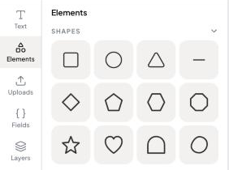

You can fully customize the look and feel of the documents Festie generates to match your festival's branding.

Navigate to `Subfest > Templates`. 

You will find four categories of templates: **Certificates**, **Sheets**, **Posters**, and **ID Cards**.

---

## Editing Existing Templates

Festie provides default templates that you can easily tweak:
1. Open a template (e.g., *Certificate of Merit*).
2. **Backgrounds & Colors:** You can upload a new background image and change the page background colour, or make it transparent. See [Change the page background](#change-the-page-background).
3. **Logos:** You don't need to manually place your logo on every template; the system will automatically inject your festival's logo when generating the document.
4. **Text & Content:** You can edit the static text on the template.

<Warning>
  You will see "Variables" in the text like `$1`, `$2`, or `$3`. **Do not delete or change these variables.** The system uses them to inject the actual candidate names, chest numbers, and programme names when the document is generated.
</Warning>

### Poster Ad Spaces
If you are generating promotional Posters for your programmes, the templates often include designated "Ad Spaces" at the bottom. You can upload sponsor logos or banners into these specific dimensions.

---

## Creating a Custom Template

If you want a completely unique design from scratch:
1. Click **New Template** and choose **Custom Template**.
2. Give it a name and select the paper size (e.g., ID Card Size).
3. Upload your custom background image.
4. Drag and drop data fields (like Candidate Name, Team, QR code) wherever you want them to appear over your background.
5. Save the template. It will now be available as an option whenever you download ID cards or certificates!

---

## Show ranks as 1st, 2nd, 3rd

Result templates, such as result posters and programme certificates, can print the position as an English ordinal: 1st, 2nd, 3rd, 4th, 11th, 21st. Anyone who can edit the template can add it.

1. Open a result template in the editor.
2. Select a text layer.
3. In the toolbar, click **Add fields** (or **Fields**). You can also use the **Fields** tab in the left panel.
4. Insert **Rank English**.

**Rank English** works whether the position was entered as "1" or "First". If the result has no position, it prints nothing. To print the position as entered, such as "1", use **Result Position** instead.

<Tip>
  For topper posters and lists, use **Topper Rank English** to print 1st, 2nd, 3rd. **Topper Rank** prints 1, 2, 3.
</Tip>

---

## Change the page size

Anyone who can edit the template can change its page size.

1. Open a template in the editor.
2. In the left panel, click **Settings**.
3. Under **Page size**, click a preset: **A4 Landscape**, **A4 Portrait**, **16:9 Wide** or **Square**. Each preset shows its size under its name.
4. For your own size, go to **Custom size** and enter a **Width** and **Height**. Use the landscape and portrait buttons to swap them.
5. Click **Resize**.

## Change the page unit

You can choose the unit the editor uses for sizes and positions. Anyone who can edit the template can change it.

1. Open a template in the editor.
2. In the left panel, click **Settings**.
3. Under **Page size**, next to **Unit**, click **px**, **mm**, **cm** or **in**.

The unit is saved with the template. Everyone who opens this template sees the same unit. New templates start in **px**.

The unit is used in these places, and each field shows it at the end:

- The page size presets.
- **Width** and **Height** under **Custom size**.
- A selected layer's **X**, **Y**, **Width** and **Height**, in the **Frame** section of the side panel and in the toolbar under **…** > **Position**.

**Rotation** stays in degrees. Font size, border width and table sizes do not change.

<Note>
  Switching units only changes how the numbers are shown. Your design and your PDF or image export stay exactly the same. One inch equals 96 px, or 25.4 mm.
</Note>

## Change the page background

Every page has a background colour. It is white by default. You can pick another colour or make the page transparent. Anyone who can edit the template can change it.

1. Open a template in the editor.
2. Click an empty part of the page. You can also click the **Background** row at the bottom of the **Layers** panel.
3. In the toolbar, click the **Page background** colour button.
4. Pick a colour, or pick the transparent swatch. It looks like a checkerboard with a slash and is labelled **No color**.

You can also change it in these places:

- In the toolbar, click **Edit** to open the background panel. Pick a colour from the **Document colors** list. This panel also lets you add, replace or remove a background image.
- Click the page settings button in the top bar and use **Page background**.
- When you create a new template, set **Page Background** in the create dialog.

When the page is transparent, the editor shows a grey checkerboard behind your design. The checkerboard only appears in the editor. It is never printed or exported.

In a template with several pages, each page has its own background. Select a page and change its background the same way.

### What a transparent page looks like in downloads

- **Images** (such as posters): you get a PNG file with a see-through background. A zip of several images contains PNG files. If any page of the template is transparent, all its image downloads are PNG.
- **Images with a page colour**: you get a JPG file, as before.
- **PDFs**: no page colour is printed. Only your design shows.
- **Print sheets** that place several items on one page (such as trophy or ID card sheets) still print on a white sheet.

The template thumbnail in your template list shows the page colour. It is see-through only when the page background is transparent.

---

## Use conditions to pick a design

A template can have several conditions. Each condition has its own design and a rule that says which items it is for. For example, winners can get one certificate design and everyone else another. Anyone who can edit templates can set conditions.

The conditions show as cards on the right of the editor. Click a card to edit its design.

1. Open a template in the editor.
2. To add a condition, click the **+** button below the cards (**Add condition**).
3. Hover over a condition card, open its menu and click **Conditions**. You can also open the **Conditions** tab in the left panel.
4. Type a **Condition name**.
5. Under **Configure the conditions**, pick who the condition is for:
   - **Anyone**, or **All programmes** or **All candidates**, depending on the template.
   - A ready-made option, such as **Winners only** or **Not placed**, or one of the template's default conditions.
   - **Custom rule** to build your own rule.

When you download, each programme or result gets the design of the first condition whose rule matches it.

### Build a custom rule

1. Pick **Custom rule**.
2. Choose **All rules must match** or **Any rule can match**.
3. Click **Add rule**.
4. Pick a **Field**, such as **Category**, **Programme Type**, **Position**, **Result Rank**, **Grade**, **Total Score**, **Score Percentage**, **Total Points** or **Candidate Avatar**. The list only shows the fields that fit your template.
5. Pick a **Condition**, such as **is**, **is not**, **is one of**, **is none of**, **has a value** or **has no value**. Number fields also offer **is more than**, **is at least**, **is less than** and **is at most**.
6. Enter or pick the **Value**. **has a value** and **has no value** need no value.

A short sentence under the options sums up your rule, for example "Download if Position has a value".

### Use a collection in a condition

If your programmes use collections, each collection key is its own field. For example, if your programmes have a "Stage" key with the values "Main stage" and "Hall B", the **Field** list shows **Stage**.

1. Pick **Custom rule** and click **Add rule**.
2. In **Field**, pick the collection key, such as **Stage**. You can search the list.
3. In **Condition**, pick **is**, **is not**, **is one of**, **is none of**, **has a value** or **has no value**.
4. In **Value**, pick a value from the list, such as **Main stage**. With **is one of** or **is none of**, you can pick several values.

If a programme has several values for the same key, **is** matches when any of them is the value you picked.

Collection fields show on programme templates, candidate certificates and posters, and trophy templates. They do not show on ID cards or topper posters. On festival-level templates, the values come from all sub-fests.

---

## Add shapes

Use shapes for borders, badges, dividers and decorative blocks. Anyone who can edit templates can add them.

1. Open a template in the editor.
2. In the left panel, click **Elements**.
3. Under **Shapes**, click a shape to add it to the page, or drag it onto the page.

<Frame></Frame>

You can choose from **Rectangle**, **Circle**, **Triangle**, **Line**, **Diamond**, **Pentagon**, **Hexagon**, **Octagon**, **Star**, **Heart**, **Arch** and **Blob**.

<Tip>
  You can also press **S** to open the **Add shape** dialog and pick a shape there. In this dialog, the circle is called **Ellipse**.
</Tip>

### Style a shape

Select a shape on the page, then click **Edit** in the left panel. The **Shape** section lets you change:

- **Shape kind**: switch to a different shape.
- **Stroke style**: **Solid**, **Dashed** or **Dotted**.
- **Stroke width** and **Stroke** colour.
- **Fill**: a solid colour or a gradient.
- **Opacity**.
- **Corner radius**: rectangles only.

Drag the handles to resize or rotate a shape. Shapes stretch freely, so you can make a wide hexagon or a tall star. Your PDF or image export looks exactly like the shape in the editor.

<Note>
  The **Frames** section uses the same outlines. A frame holds an image inside the outline. A shape is a filled outline with no image.
</Note>
