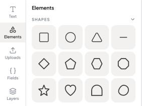

Festie ജനറേറ്റ് ചെയ്യുന്ന ഡോക്യുമെന്റുകൾ നിങ്ങളുടെ ഫെസ്റ്റിവലിന്റെ ഡിസൈൻ അനുസരിച്ച് പൂർണ്ണമായി മാറ്റിയെടുക്കാൻ (customize) സാധിക്കും.

`Subfest > Templates` ഓപ്പൺ ചെയ്യുക.

അവിടെ നിങ്ങൾക്ക് നാല് തരം ടെംപ്ലേറ്റുകൾ കാണാം: **Certificates**, **Sheets**, **Posters**, **ID Cards**.

---

## നിലവിലുള്ള ടെംപ്ലേറ്റുകൾ മാറ്റാൻ (Editing Existing Templates)

Festie തരുന്ന ഡിഫോൾട്ട് ഡിസൈനുകൾ നിങ്ങൾക്ക് എളുപ്പത്തിൽ മാറ്റിയെടുക്കാം:
1. ഒരു ടെംപ്ലേറ്റ് ഓപ്പൺ ചെയ്യുക (ഉദാ: *Certificate of Merit*).
2. **Backgrounds & Colors:** പുതിയ ബാക്ക്ഗ്രൗണ്ട് ഇമേജ് അപ്‌ലോഡ് ചെയ്യാം, കളർ മാറ്റാം, ഒപാസിറ്റി (opacity) അഡ്ജസ്റ്റ് ചെയ്യാം.
3. **Logos:** ഓരോ ടെംപ്ലേറ്റിലും നിങ്ങൾ ലോഗോ കൊടുക്കേണ്ട ആവശ്യമില്ല; ഡോക്യുമെന്റ് പ്രിന്റ് ആകുമ്പോൾ സിസ്റ്റം തനിയെ ലോഗോ വെച്ചോളും.
4. **Text & Content:** ടെംപ്ലേറ്റിലെ മാറ്റമില്ലാത്ത ടെക്സ്റ്റുകൾ നിങ്ങൾക്ക് മാറ്റാൻ സാധിക്കും.

<Warning>
  ടെക്സ്റ്റുകൾക്കിടയിൽ `$1`, `$2`, `$3` എന്നിങ്ങനെ ചില "Variables" കാണാൻ സാധിക്കും. **അവ ഡിലീറ്റ് ചെയ്യുകയോ മാറ്റുകയോ ചെയ്യരുത്.** ഡോക്യുമെന്റ് ജനറേറ്റ് ചെയ്യുമ്പോൾ അവിടെ കുട്ടിയുടെ പേര്, നെഞ്ച് നമ്പർ, പ്രോഗ്രാമിന്റെ പേര് എന്നിവ വരാനുള്ള കോഡാണത്.
</Warning>

### Poster Ad Spaces
നിങ്ങൾ പ്രോഗ്രാമുകൾക്കുള്ള പോസ്റ്ററുകൾ ആണ് ജനറേറ്റ് ചെയ്യുന്നതെങ്കിൽ, പല ടെംപ്ലേറ്റുകളിലും താഴെയായി "Ad Spaces" കാണാൻ സാധിക്കും. സ്പോൺസർമാരുടെ ലോഗോയോ പരസ്യമോ ഒക്കെ നിങ്ങൾക്ക് അവിടെ കൊടുക്കാവുന്നതാണ്.

---

## സ്വന്തമായി ടെംപ്ലേറ്റ് ഉണ്ടാക്കാൻ (Custom Template)

നിങ്ങൾക്ക് പൂർണ്ണമായും പുതിയൊരു ഡിസൈൻ സ്വന്തമായി ഉണ്ടാക്കണമെങ്കിൽ:
1. **New Template** ക്ലിക്ക് ചെയ്ത് **Custom Template** തിരഞ്ഞെടുക്കുക.
2. പേര് കൊടുത്ത് പേപ്പറിന്റെ സൈസ് സെലക്ട് ചെയ്യുക (ഉദാ: ID Card Size).
3. നിങ്ങളുടെ സ്വന്തം ബാക്ക്ഗ്രൗണ്ട് ഡിസൈൻ അപ്‌ലോഡ് ചെയ്യുക.
4. കുട്ടിയുടെ പേര്, ടീം, ക്യൂആർ കോഡ് (QR code) തുടങ്ങിയ കാര്യങ്ങൾ നിങ്ങൾക്ക് ബാക്ക്ഗ്രൗണ്ടിൽ എവിടെയാണോ വരേണ്ടത്, അവിടെ വലിച്ചുകൊണ്ടുവന്ന് വെക്കുക (drag and drop).
5. ടെംപ്ലേറ്റ് സേവ് ചെയ്യുക. ഇനി മുതൽ ഐഡി കാർഡോ സർട്ടിഫിക്കറ്റോ ഡൗൺലോഡ് ചെയ്യുമ്പോൾ നിങ്ങളുടെ ഈ പുതിയ ഡിസൈൻ അവിടെ കാണാവുന്നതാണ്!

---

## ഷേപ്പുകൾ ചേർക്കാൻ (Add shapes)

ബോർഡറുകൾ, ബാഡ്ജുകൾ, ഡിവൈഡറുകൾ, ഡിസൈൻ ബ്ലോക്കുകൾ എന്നിവയ്ക്ക് ഷേപ്പുകൾ ഉപയോഗിക്കാം. ടെംപ്ലേറ്റുകൾ എഡിറ്റ് ചെയ്യാൻ അനുവാദമുള്ള ആർക്കും ഇവ ചേർക്കാം.

1. ഒരു ടെംപ്ലേറ്റ് എഡിറ്ററിൽ ഓപ്പൺ ചെയ്യുക.
2. ഇടതുവശത്തെ പാനലിൽ **Elements** ക്ലിക്ക് ചെയ്യുക.
3. **Shapes** എന്നതിന് താഴെ ഒരു ഷേപ്പിൽ ക്ലിക്ക് ചെയ്യുക, അല്ലെങ്കിൽ അത് പേജിലേക്ക് വലിച്ചിടുക (drag).

<Frame></Frame>

**Rectangle**, **Circle**, **Triangle**, **Line**, **Diamond**, **Pentagon**, **Hexagon**, **Octagon**, **Star**, **Heart**, **Arch**, **Blob** എന്നിവയിൽ നിന്ന് തിരഞ്ഞെടുക്കാം.

<Tip>
  **S** അമർത്തിയാൽ **Add shape** ഡയലോഗ് തുറക്കും, അവിടെ നിന്നും ഷേപ്പ് തിരഞ്ഞെടുക്കാം. ഈ ഡയലോഗിൽ circle-ന്റെ പേര് **Ellipse** എന്നാണ്.
</Tip>

### ഷേപ്പിന്റെ സ്റ്റൈൽ മാറ്റാൻ (Style a shape)

പേജിലെ ഒരു ഷേപ്പ് സെലക്ട് ചെയ്ത്, ഇടതുവശത്തെ പാനലിൽ **Edit** ക്ലിക്ക് ചെയ്യുക. **Shape** സെക്ഷനിൽ ഇവ മാറ്റാം:

- **Shape kind**: മറ്റൊരു ഷേപ്പിലേക്ക് മാറ്റാം.
- **Stroke style**: **Solid**, **Dashed**, **Dotted**.
- **Stroke width**, **Stroke** കളർ.
- **Fill**: ഒരു കളർ അല്ലെങ്കിൽ ഗ്രേഡിയന്റ് (gradient).
- **Opacity**.
- **Corner radius**: Rectangle-ന് മാത്രം.

ഹാൻഡിലുകൾ വലിച്ച് ഷേപ്പിന്റെ വലുപ്പം മാറ്റാം, തിരിക്കാം (rotate). ഷേപ്പുകൾ ഇഷ്ടമുള്ള രീതിയിൽ വലിച്ചുനീട്ടാം. എഡിറ്ററിൽ കാണുന്നതുപോലെ തന്നെയാകും PDF അല്ലെങ്കിൽ ഇമേജ് എക്സ്പോർട്ടിലും.

<Note>
  **Frames** സെക്ഷനിലും ഇതേ ഔട്ട്‌ലൈനുകളാണ് ഉള്ളത്. ഫ്രെയിമിനുള്ളിൽ ഒരു ഇമേജ് വെക്കാം. ഷേപ്പ് എന്നത് ഇമേജ് ഇല്ലാത്ത, കളർ നിറച്ച ഒരു ഔട്ട്‌ലൈൻ ആണ്.
</Note>
